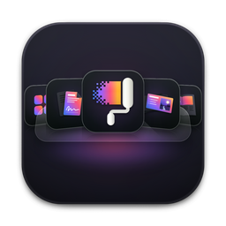
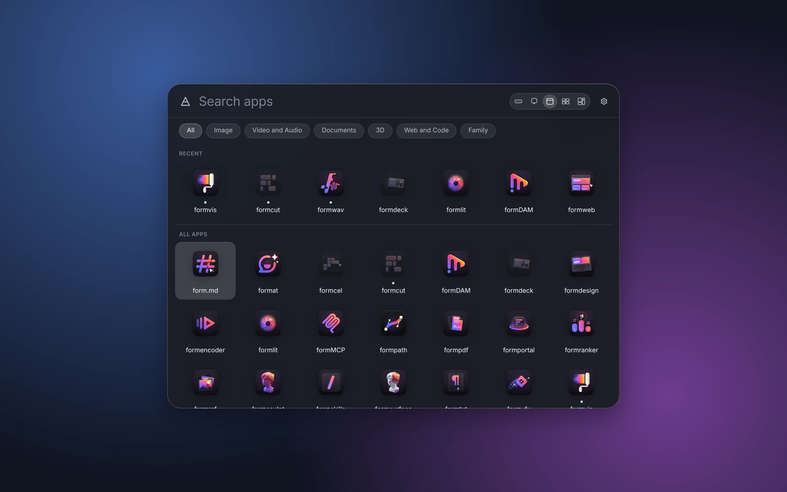
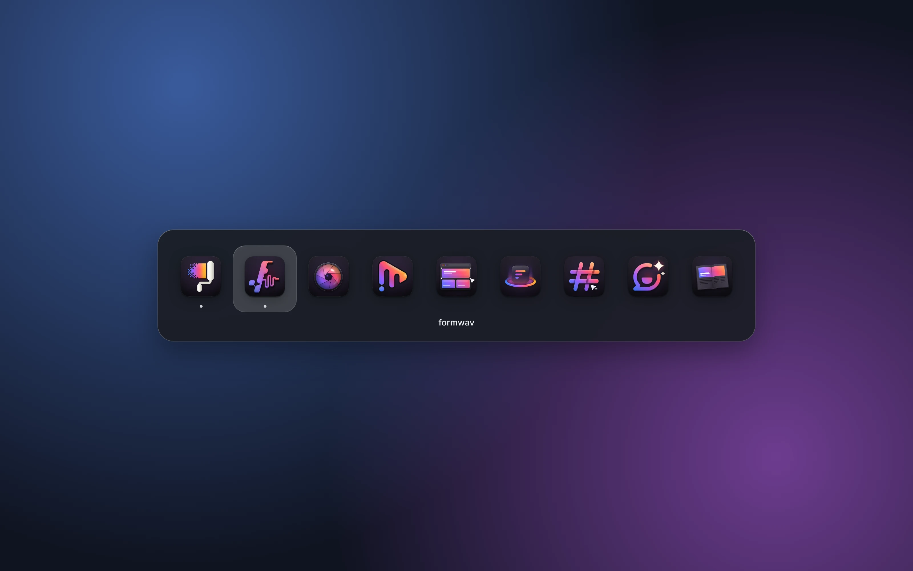
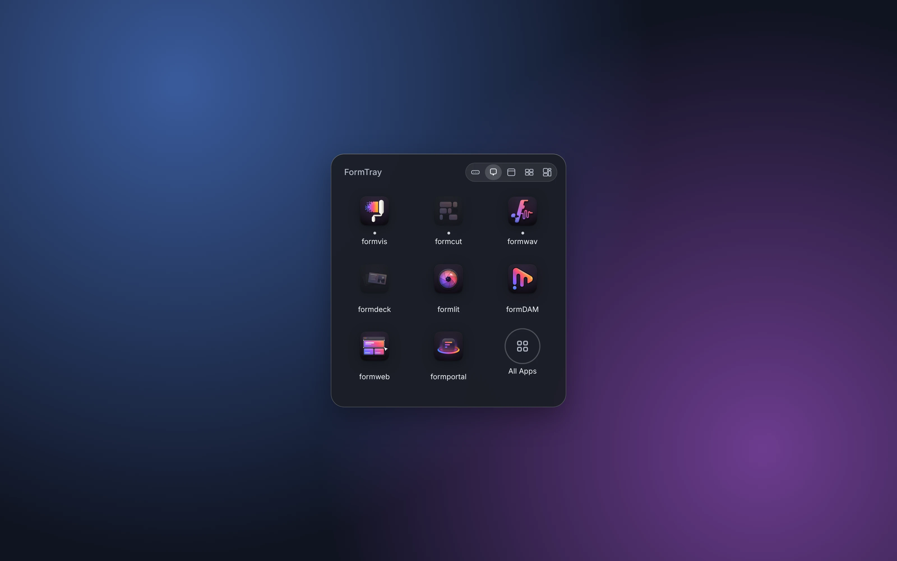
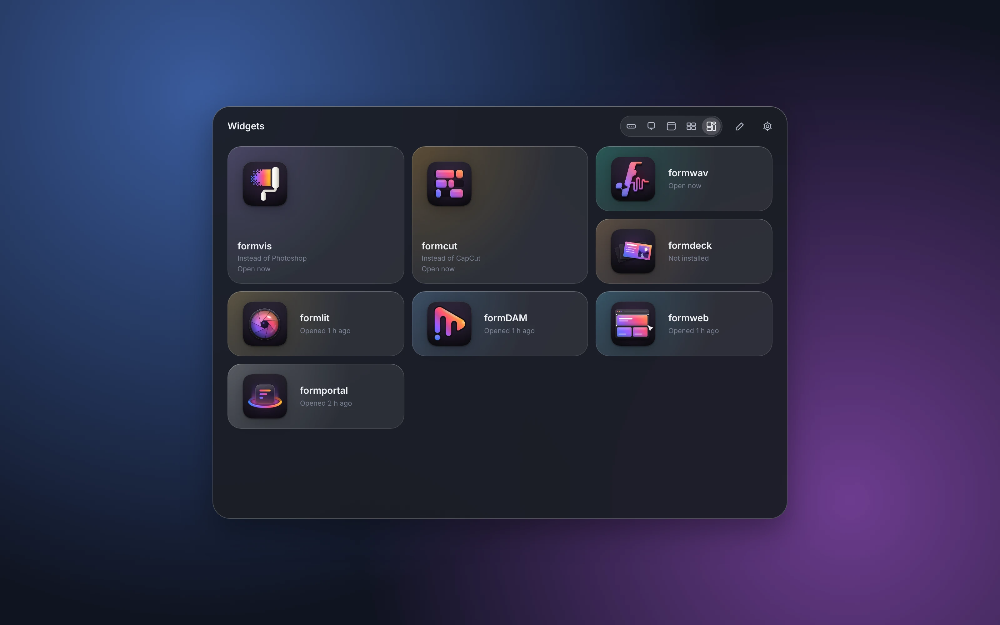
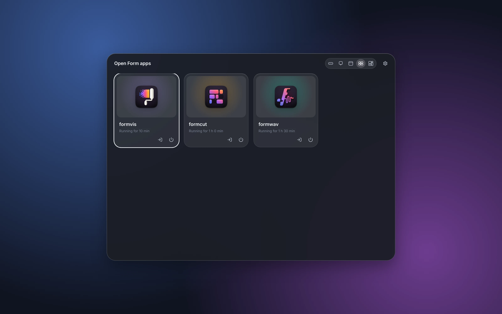

<p align="center">
  
</p>

<h1 align="center">FormTray</h1>

<p align="center">
  <b>Launcher; one dock icon for every Form app.</b><br>
  Switch, launch and arrange the whole family from five views on glass,<br>
  with rebindable hotkeys and no network access. Rust core, on your own computer.
</p>

<p align="center">
  
  
  
  
  
  
</p>

<p align="center">
  <a href="https://formtray.formai.studio/"><b>Download FormTray on formai.studio</b></a> ·
  <a href="https://github.com/nodemode-dev/formcompiler/releases/tag/formtray-v0.9.8">Latest release</a> ·
  <a href="#run-it-from-source">Run it from source</a>
</p>

<br>

<p align="center">
  
  <br>
  <sub>The Apps view, with sample running and recent state: a search field, categories, recents and every app in one panel.</sub>
</p>

<p align="center">
  <a href="#features">Features</a> ·
  <a href="#everything-in-the-box">In the box</a> ·
  <a href="#built-for-agents">Agents</a> ·
  <a href="#under-the-hood">Under the hood</a> ·
  <a href="#download">Download</a> ·
  <a href="#run-it-from-source">Run from source</a>
</p>

<br>

<table>
  <tr>
    <td width="25%" valign="top"><h3>One icon, every released app</h3>Pin FormTray instead of an icon per app. It lists only released Form family apps, so unreleased and non-family apps never show. Every view reads one state, so recents and running dots agree. The menu bar menu lists open apps and the apps chosen "In menu bar" in Settings.</td>
    <td width="25%" valign="top"><h3>Real system glass</h3>macOS 26 gets a native glass material, older macOS vibrancy, Windows acrylic and Linux solid themed panels.</td>
    <td width="25%" valign="top"><h3>Hotkeys that behave</h3>Defaults avoid each system's reserved chords. Rebind any of them in Settings; clashes are refused, not ignored.</td>
    <td width="25%" valign="top"><h3>Agent-ready</h3>The same engine runs from the window and from a command line that lists, opens and quits apps.</td>
  </tr>
</table>

<br>

## Features

<table>
  <tr>
    <td width="50%" valign="top"><br><sub>The Switcher, a Cmd+Tab-style strip.</sub>
      <h3>Switch in one frame</h3>Hold the modifier and tap to move along the strip. The view appears the instant the hotkey is pressed.</td>
    <td width="50%" valign="top"><br><sub>The Stack, the Form apps open right now.</sub>
      <h3>A Stack of what is open</h3>The Stack shows the Form apps that are open right now, in launch order, with a Quit button on each: FormTray in place of the Dock for the family. Apps opened from FormTray are launched with `--formtray-hosted` (and `FORMTRAY_HOSTED=1`), so family apps that support it stay out of the Dock; macOS lets only the app itself hide its Dock icon. The Dock icon opens the view you last chose; Widgets is the default.</td>
  </tr>
  <tr>
    <td width="50%" valign="top"><br><sub>The Widgets board, arranged by you.</sub>
      <h3>Widgets you arrange</h3>App tiles in three sizes, groups that open as a pop-over, and a FormPortal Updates tile that never fetches.</td>
    <td width="50%" valign="top"><br><sub>The Windows view, for apps that are open.</sub>
      <h3>See what is running</h3>One card per open app with how long it has run, a button to bring it forward and one to quit it.</td>
  </tr>
</table>

## Everything in the box

<table>
  <tr>
    <td width="33%" valign="top"><h4>5 views plus Settings</h4>Switcher · Stack · Apps · Windows · Widgets · Settings</td>
    <td width="33%" valign="top"><h4>Released apps, 6 categories</h4>Image · Video and Audio · Documents · 3D · Web and Code · Family</td>
    <td width="33%" valign="top"><h4>Platforms</h4>macOS (Dock, menu bar) · Windows (taskbar) · Linux (X11 hotkeys, Wayland by command)</td>
  </tr>
</table>

## Built for agents

`formtray-cli` runs the same engine as the window, without opening it. It has no MCP server.

```sh
./formtray cli list --json      # every Form app, whether it is installed and running
./formtray cli open <app>       # open an app, or bring it forward if it is running
./formtray cli updates          # updates FormPortal has seen (read only, no network)
```

`./formtray cli hotkeys`, `quit <app>`, `hotkey <action> <chord>` and `where` complete it. See [`CLAUDE.md`](CLAUDE.md).

## Under the hood

- **Engine:** `formtray-core` holds the app registry, discovery, open, focus, quit, running state, preferences and hotkey tables.
- **Shell:** a Tauri 2 shell for panels, glass, the menu bar, hotkeys, Dock reopen, single instance and autostart.
- **Interface:** vanilla TypeScript and Vite with zero runtime dependencies.
- **Finds apps by name:** reads FormPortal's install record first, then every bundle identifier and name each app has shipped under.
- **Release gated:** only Form family apps whose release wave has opened (or that FormPortal's catalogue shows as released) are listed, under their canonical names (FormVis, FormCut, FormWav, form.md, FormDeck, FormBench, FormAT, FormMCP, FormSkills, FormDAM and the rest). Icons are the owner's 34-app pack, dark and light, following the system appearance.
- **Offline:** FormTray never touches the network. It reads, but never writes, FormPortal's data at `studio.formai.portal` (falling back to `dev.formai.portal`): `installed.json` and the catalogue.
- **Tested:** 17 Rust tests (registry, settings and the family contract).

## Download

| Platform | Download | Release |
|---|---|---|
| macOS | [Download FormTray for macOS](https://formai.studio/get/formtray/macos) | [FormTray releases on FormCompiler](https://github.com/nodemode-dev/formcompiler/releases?q=formtray-v&expanded=true) |
| Windows | [Download FormTray for Windows](https://formai.studio/get/formtray/windows) | [FormTray releases on FormCompiler](https://github.com/nodemode-dev/formcompiler/releases?q=formtray-v&expanded=true) |
| Linux | [Download FormTray for Linux](https://formai.studio/get/formtray/linux) | [FormTray releases on FormCompiler](https://github.com/nodemode-dev/formcompiler/releases?q=formtray-v&expanded=true) |

All FormTray builds are compiled and released from [FormCompiler](https://github.com/nodemode-dev/formcompiler); this repo holds the source.

## Run it from source

Prefer it in your browser, or want to contribute? Run the interface straight from this repo.

**Requires:** Rust (stable), Node 20.19+, and on Linux WebKitGTK 4.1 for the desktop window (the installer prints the packages).

```sh
git clone git@github.com:nodemode-dev/formtray.git
cd formtray
./formtray_oc_install   # checks tools, installs the interface packages, fetches the Rust crates
./formtray              # starts the interface on port 5610 and the desktop app
```

In a browser, `cd frontend && npm run dev` then open `http://localhost:5610/?view=apps` (or `switcher`, `stack`, `windows`, `widgets`, `prefs`). The browser build shows sample running and recent state.

On Windows run `formtray_oc_install.bat`, then `formtray.bat`. `./build_app` builds the bundles locally.

Default hotkeys: the Switcher is Option + Tab on macOS and Alt + ` on Windows and Linux (X11). On Wayland, bind `formtray --view apps` (or `switcher`, `stack`, `windows`, `widgets`) in your desktop's keyboard settings.

> [!IMPORTANT]
> **Status:** released. Add a Form app by adding one entry to `core/data/apps.json`; it shows once its release wave opens. FormPortal installs and updates apps; FormTray only opens and switches them.

**Contributing:** branch from `main`, keep changes to source here, and leave packaging and releases to formcompiler. See [`CLAUDE.md`](CLAUDE.md).

## Demo

[`demo/`](demo/README.md) runs the real views in any browser with no install: open `demo/index.html`. It has a built-in sample FormPortal record, reads your own `installed.json` and `catalog/apps.json`, launches and quits apps in the page, rebinds hotkeys, and answers `formtray cli` commands. Rebuild it with `npm run build:demo` in `frontend/`.

## Repository

| Path | What it is |
|---|---|
| `core/` | The engine: registry (`core/data/apps.json`), discovery, open, focus, quit, running state, prefs, hotkeys |
| `cli/` | `formtray-cli`: `list`, `open`, `quit`, `hotkeys`, `hotkey`, `updates`, `where` |
| `src-tauri/` | The window shell: panels, glass, menu bar, hotkeys, single instance |
| `frontend/` | The interface: the views, tokens and the layer scale (dev server on 5610) |
| `assets/` | The app icon and the icon and tray sources in `icon_src/` |
| `build_app`, `build_app.bat` | One-shot desktop builds |

<br>

---

## Maintainers

| Maintainer | Role |
|---|---|
| [@nodemode-ai](https://github.com/nodemode-ai) | Owner |
| [@gbarnai](https://github.com/gbarnai) | Co-owner |

Code owners are set in [`.github/CODEOWNERS`](.github/CODEOWNERS).

## License

FormTray is licensed under the Apache License 2.0 ([`LICENSE`](LICENSE), SPDX `Apache-2.0`). Copyright 2026 NodeAgentc, Inc. Third-party notices: [`NOTICE.md`](NOTICE.md).

<sub>Apple, macOS and Liquid Glass are trademarks of Apple Inc. Windows is a trademark of the Microsoft group of companies. FormTray is an independent project and is not affiliated with or endorsed by them.</sub>
