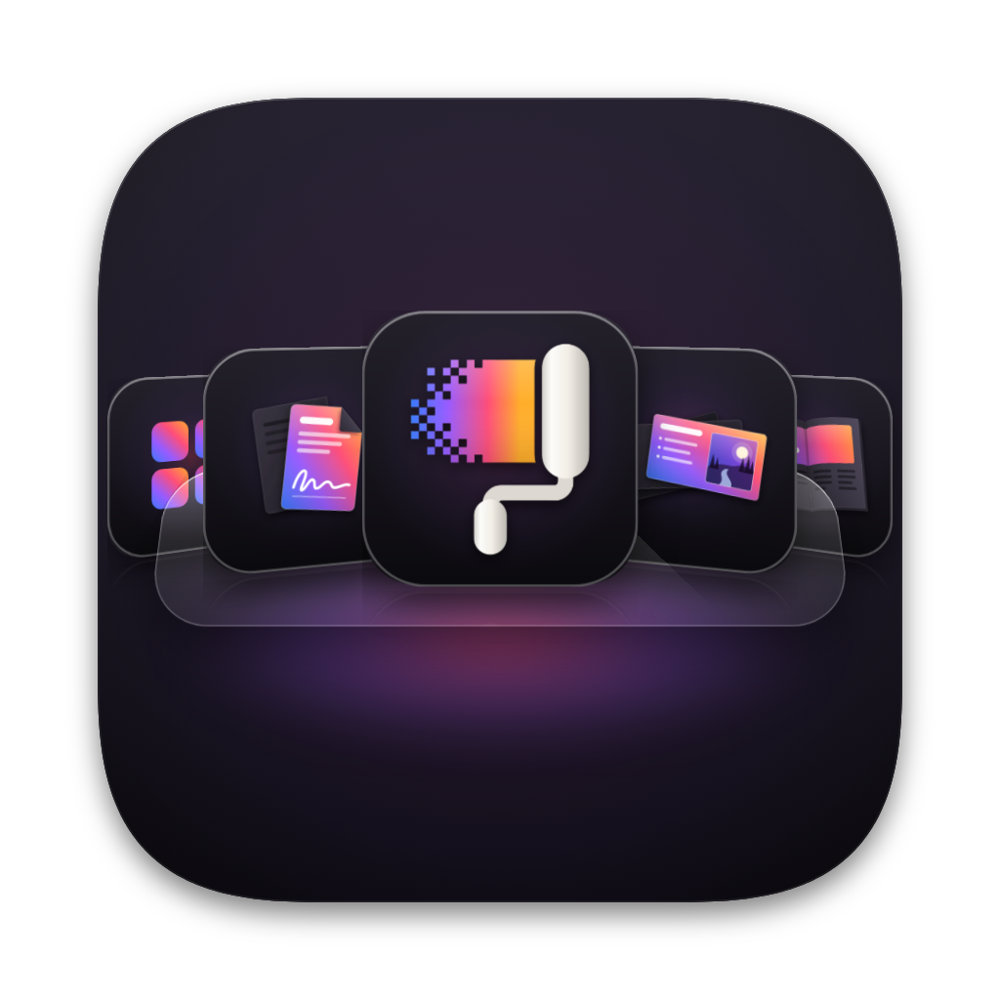

<p align="center"></p>

<h1 align="center">FormTray</h1>

<p align="center"><b>One dock icon for every Form app. Switch, launch and arrange the whole family from five views, on Liquid Glass.</b></p>

<p align="center">
  
  
  
  
  
</p>

FormTray is a launcher and switching station for the 19 built Form apps. You pin one icon instead of nineteen. Click it in the Dock and a Stack pops up above it. Press a hotkey and the Switcher, the Apps panel, the open-app cards or your Widgets board appears in one frame. It opens and switches apps only; installing and updating stay in FormPortal.

**Stack:** Rust (`formtray-core`, `formtray-cli`) · Tauri 2 shell · vanilla TypeScript + Vite interface with zero runtime dependencies · **Scale:** 19 apps from one registry, 5 views plus Settings, 3 operating systems

## Highlights

- **Five views, one engine.**
  - Switcher: a Cmd+Tab-style strip.
  - Stack: a Dock folder grid.
  - Apps: a searchable panel with categories.
  - Windows: cards for the apps that are open.
  - Widgets: a board you arrange.

  Every view reads the same state, so pins, recents and running dots always agree.
- **Real Liquid Glass.** On macOS 26 each panel's web content sits inside an `NSGlassEffectView`, not a CSS imitation. Older macOS gets vibrancy, Windows gets acrylic, and Linux gets solid themed panels.
- **Hotkeys that do not fight the system.** Defaults are chosen per OS around the reserved chords, including FormRef's. Problems are reported in Settings rather than failing silently.
- **Finds the apps however they were built.** FormTray reads FormPortal's install record first. Each app also carries every bundle identifier and name it has shipped under, so drift between an app and FormPortal's catalogue does not hide it.
- **Widgets you arrange.** The board holds:
  - app tiles in three sizes
  - groups of apps that open as a pop-over
  - a FormPortal Updates tile counting what FormPortal has already seen

  The Updates tile reads FormPortal's files and never fetches.
- **Rebind any hotkey in Settings.** Click it and press the new chord. FormTray refuses a chord the system or another FormTray action already uses, and Default puts the original back.
- **Idles in the menu bar.** Once opened, FormTray waits until a hotkey, the Dock icon or the menu bar calls it. Open at login is off by default.
- **Never touches the network.**

## Quick start

Requirements: Rust (stable), Node 20.19+, and on Linux WebKitGTK 4.1 (the installer prints the packages).

```bash
./formtray_oc_install        # macOS / Linux
./formtray                   # starts the interface on 5610 and the app
./formtray cli list          # the engine without a window
```

On Windows run `formtray_oc_install.bat`, then `formtray.bat`.

## Build the desktop app

`./build_app` does everything from a fresh clone on macOS or Linux: it checks the tools (installing Rust with rustup when missing), installs the interface packages and the Rust crates, builds the interface, compiles the app and bundles it. Every step is logged to `build_app.log`.

| OS | Run | You get (under `target/release/bundle/`) |
| --- | --- | --- |
| macOS | `./build_app` | `macos/FormTray.app` and `dmg/FormTray_<version>_<arch>.dmg`; the app is copied to Applications (`--no-install` keeps it in place) |
| Linux | `./build_app` | `deb/`, `rpm/` and `appimage/` packages; `--install` installs the .deb with apt or the .rpm with dnf, `--bundles deb` builds fewer kinds |
| Windows | `build_app.bat` | `msi/FormTray_<version>_x64_en-US.msi` and `nsis/FormTray_<version>_x64-setup.exe` |

`--open` opens the result and `--clean` rebuilds the Rust side from nothing. Linux needs the WebKitGTK 4.1, appindicator and librsvg build packages; `./build_app` names them for apt, dnf and pacman when they are missing. Windows needs Rust's MSVC toolchain and the Visual Studio C++ build tools; WebView2 ships with Windows 10 and 11. Without an Apple signing identity the macOS app is ad-hoc signed, so macOS asks once before it opens.

Pushing a `v*.*.*` tag runs `.github/workflows/desktop.yml`, which builds all four (macOS arm64 and x64, Linux x64, Windows x64) and drafts a release with the installers.

## Hotkeys

| Action | macOS | Windows | Linux (X11) |
| --- | --- | --- | --- |
| Switcher (hold the modifier, tap) | Option + Tab | Alt + ` | Alt + ` |
| Show the last view | Control + Option + Command + Space | Ctrl + Shift + Space | Super + Shift + Space |
| Views 1 to 5 | Control + Option + Command + 1 to 5 | Ctrl + Shift + Alt + 1 to 5 | Super + Shift + 1 to 5 |

Inside any view:

| Key | Action |
| --- | --- |
| 1 to 5 | Switch view |
| Arrow keys | Move the selection |
| Enter | Open |
| Esc | Close |
| Cmd or Ctrl + , | Settings |

On Wayland, which gives apps no global hotkeys, bind `formtray --view apps` (or `switcher`, `stack`, `windows`, `widgets`) in your desktop's keyboard settings. The running FormTray receives the request.

## Where things live

| Path | Role |
| --- | --- |
| `core/` | The engine: registry (`core/data/apps.json`), discovery, open, focus, quit, running state, prefs, hotkey tables |
| `cli/` | `formtray-cli list`, `open`, `quit`, `hotkeys`, `hotkey <action> <chord>`, `updates` and `where` |
| `src-tauri/` | The window shell: panels, glass, menu bar, hotkeys, Dock reopen, single instance and autostart |
| `frontend/` | The interface: the views, tokens, and the layer scale |
| `assets/` | Repo art: `formtray_icon.png`, the macOS icon, and the icon and tray sources in `icon_src/` |
| `build_app`, `build_app.bat` | One-shot desktop builds for macOS and Linux, and for Windows |

| Port | Service |
| --- | --- |
| 5610 | Vite dev server (localhost only) |

Preferences and usage are JSON files under the OS config folder; `./formtray cli where` prints the exact path. FormTray reads, but never writes, FormPortal's `installed.json` and `catalog/apps.json`. These are in FormPortal's folder: `~/Library/Application Support/dev.formai.portal` on macOS, `%LOCALAPPDATA%\FormPortal` on Windows and `~/.local/share/formportal` on Linux. `FORMPORTAL_ROOT` overrides the location.

## Adding a Form app

Add one entry to `core/data/apps.json`, with its id, name, category, hue, icon, every bundle identifier and every bundle or executable name. Then put its 256 px icon in `frontend/public/apps/`. No code changes are needed.

## Licence

Apache-2.0. Dependencies are MIT or Apache-2.0; see `src-tauri/Cargo.toml` and `core/Cargo.toml`.
